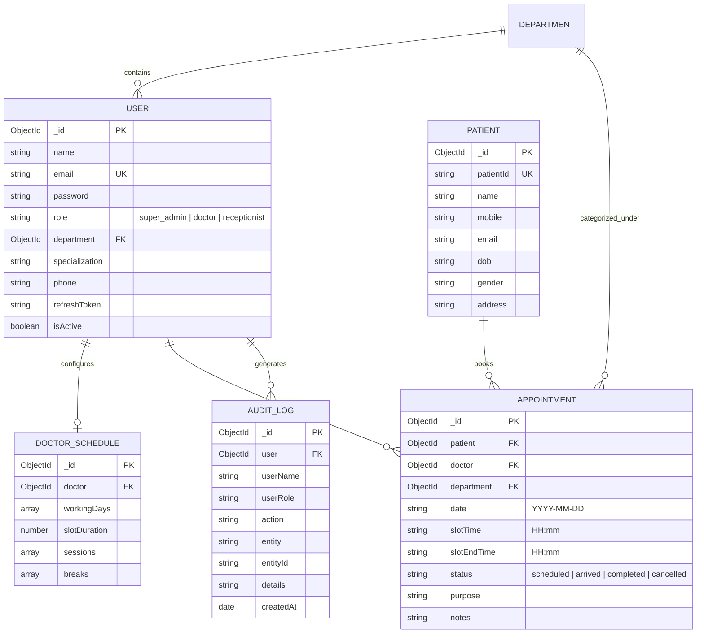

# Enterprise Electronic Medical Record (EMR) Appointment Management System

A production-ready Appointment Management module for an Enterprise EMR system built with the MERN stack (MongoDB, Express, React, Node.js) with real-time WebSocket updates, Role-Based Access Control (RBAC), and atomic double-booking concurrency prevention.

---

## 📑 Table of Contents
- [Project Overview](#project-overview)
- [Folder Structure](#folder-structure)
- [Architecture Overview](#architecture-overview)
- [Default Login Credentials](#default-login-credentials)
- [Database Design & Relationships](#database-design--relationships)
- [API Documentation](#api-documentation)
- [Environment Variables](#environment-variables)
- [Installation & Running the Project](#installation--running-the-project)
- [Concurrency & Double Booking Prevention](#concurrency--double-booking-prevention)
- [Assumptions Made](#assumptions-made)
- [Known Limitations](#known-limitations)
- [Future Improvements](#future-improvements)

---

## 🏥 Project Overview

This module provides a complete clinical workflow for appointment scheduling and management:
- **Authentication & RBAC**: JWT Access & Refresh token rotation, bcrypt hashing, and role protection for **Super Admin**, **Doctor**, and **Receptionist**.
- **Doctor Schedule Management**: Working days, multiple sessions per day (Morning, Evening), configurable slot duration (15m, 30m, etc.), and break timings (Lunch, Tea) with automatic break protection.
- **Dynamic Slot Generation**: In-memory slot engine that calculates available slots on the fly without storing empty placeholder documents.
- **Concurrency & Double Booking Defense**: Atomic compound unique partial index preventing race conditions during simultaneous booking attempts.
- **Real-Time Live Updates**: WebSocket push via Socket.IO for new bookings, cancellations, patient arrivals, and status updates across connected dashboards.
- **Search, Filter & Pagination**: Server-side filtering by doctor, department, date range, patient name, and mobile number.
- **Audit Logging**: Immutable audit trail recording user logins and all appointment mutations.

---

## 📁 Folder Structure

```
Clinic-appointment-system/
├── backend/
│   ├── src/
│   │   ├── config/
│   │   │   ├── db.js             # Mongoose connection
│   │   │   ├── socket.js         # Socket.IO initialization
│   │   │   └── seed.js           # Auto-seeds default users & departments
│   │   ├── controllers/
│   │   │   ├── appointmentController.js
│   │   │   ├── authController.js
│   │   │   ├── doctorController.js
│   │   │   ├── patientController.js
│   │   │   ├── slotController.js
│   │   │   ├── staffController.js
│   │   │   └── auditController.js
│   │   ├── middlewares/
│   │   │   ├── authMiddleware.js # JWT verification
│   │   │   ├── rbacMiddleware.js # Role checks
│   │   │   └── errorHandler.js   # Centralized error responses
│   │   ├── models/
│   │   │   ├── Appointment.js    # With atomic unique compound index
│   │   │   ├── AuditLog.js
│   │   │   ├── Department.js
│   │   │   ├── DoctorSchedule.js
│   │   │   ├── Patient.js
│   │   │   └── User.js
│   │   ├── routes/
│   │   │   ├── appointmentRoutes.js
│   │   │   ├── authRoutes.js
│   │   │   ├── doctorRoutes.js
│   │   │   ├── patientRoutes.js
│   │   │   ├── slotRoutes.js
│   │   │   ├── staffRoutes.js
│   │   │   └── auditRoutes.js
│   │   ├── service/
│   │   │   └── slotService.js    # Dynamic slot algorithm
│   │   └── utils/
│   │       └── generateTokens.js # JWT generator
│   ├── .env
│   ├── package.json
│   └── server.js
│
├── fronend/
│   ├── src/
│   │   ├── components/
│   │   │   └── layout/
│   │   │       ├── AppLayout.js
│   │   │       ├── Sidebar.js
│   │   │       └── Topbar.js
│   │   ├── context/
│   │   │   ├── AuthContext.js    # User state & token management
│   │   │   └── SocketContext.js  # Socket.IO connection & listeners
│   │   ├── pages/
│   │   │   ├── AppointmentsPage.js
│   │   │   ├── BookingPage.js
│   │   │   ├── DashboardPage.js
│   │   │   ├── LoginPage.js
│   │   │   ├── SchedulerPage.js
│   │   │   ├── ScheduleManagerPage.js
│   │   │   ├── StaffManagerPage.js
│   │   │   └── AuditLogsPage.js
│   │   ├── services/
│   │   │   ├── api.js            # Axios with auto refresh token interceptor
│   │   │   └── apiService.js
│   │   ├── App.js
│   │   └── index.css
│   └── package.json
│
├── ENGINEERING_DECISIONS.md
└── README.md
```

---

## 🔑 Default Login Credentials

The backend automatically seeds initial demo accounts when starting for the first time:

| Role | Email | Password | Access |
|---|---|---|---|
| **Super Admin** | `admin@clinic.com` | `admin123` | Full system access, staff, schedules, all appointments, audit logs |
| **Doctor** | `doctor@clinic.com` | `doctor123` | Assigned to General Medicine, views own appointments & patients |
| **Receptionist** | `receptionist@clinic.com` | `reception123` | Patient search, appointment booking, arrival check-in |

---

## 🗄️ Database Design & Relationships



---

## 🔌 API Documentation

All API responses follow a consistent JSON envelope standard:
```json
{
  "success": true,
  "message": "Operation successful",
  "data": {},
  "meta": {}
}
```

### Authentication Endpoints
- `POST /api/v1/auth/login`: Authenticate with email & password. Returns `accessToken`, `refreshToken`, and user info.
- `POST /api/v1/auth/refresh`: Send `refreshToken` to receive a new `accessToken`.
- `POST /api/v1/auth/logout`: Invalidate the current session `refreshToken`.

### Appointment Endpoints
- `GET /api/v1/appointments`: List appointments with filters (`search`, `status`, `department`, `doctor`, `startDate`, `endDate`, `page`, `limit`).
- `POST /api/v1/appointments`: Book new appointment (atomic double-booking check).
- `GET /api/v1/appointments/:id`: Retrieve single appointment.
- `PUT /api/v1/appointments/:id`: Update purpose, notes, or status.
- `POST /api/v1/appointments/:id/arrive`: Mark patient as arrived.
- `DELETE /api/v1/appointments/:id`: Cancel appointment (frees slot for re-booking).

### Doctor & Schedule Endpoints
- `GET /api/v1/doctors`: List all active doctors with departments.
- `POST /api/v1/doctors`: Create doctor *(Super Admin only)*.
- `GET /api/v1/doctors/:id/schedule`: Retrieve configured working schedule.
- `PUT /api/v1/doctors/:id/schedule`: Update working days, sessions, breaks, and slot duration *(Super Admin only)*.
- `GET /api/v1/departments`: List all medical departments.

### Slot Endpoints
- `GET /api/v1/slots?doctorId=...&date=YYYY-MM-DD`: Compute slots dynamically for the given doctor and date, marking `isBooked: true/false` and `isPast: true/false`.

### Patient Endpoints
- `GET /api/v1/patients/search?q=...`: Search patients by Name, Mobile, or Patient ID.
- `POST /api/v1/patients`: Create new patient record.

### Staff & Audit Endpoints
- `GET /api/v1/users/staff`: List staff members *(Super Admin only)*.
- `POST /api/v1/users/receptionists`: Create receptionist *(Super Admin only)*.
- `GET /api/v1/audit-logs`: Query audit trail with filters *(Super Admin only)*.

---

## ⚙️ Environment Variables

### Backend (`backend/.env`)
```env
PORT=5000
NODE_ENV=development
MONGODB_URI=mongodb+srv://<username>:<password>@cluster0.tbki1m3.mongodb.net/clinic_emr?retryWrites=true&w=majority
JWT_ACCESS_SECRET=your_super_secure_access_secret_change_in_production
JWT_REFRESH_SECRET=your_super_secure_refresh_secret_change_in_production
JWT_ACCESS_EXPIRES_IN=15m
JWT_REFRESH_EXPIRES_IN=7d
CLIENT_URL=http://localhost:3000
```

### Frontend (`fronend/.env`)
```env
REACT_APP_API_URL=http://localhost:5000/api/v1
REACT_APP_SOCKET_URL=http://localhost:5000
```

---

## 🚀 Installation & Running the Project

### Prerequisites
- Node.js (v18+)
- MongoDB Atlas or local MongoDB instance

### 1. Backend Setup
```bash
cd backend
npm install
npm start
```
*Backend runs on `http://localhost:5000`.*

### 2. Frontend Setup
```bash
cd fronend
npm install
npm start
```
*Frontend opens at `http://localhost:3000`.*

---

## 🛡️ Concurrency & Double Booking Prevention

Double booking is prevented through a **two-tier defense**:
1. **Tier 1 (Application level)**: Queries existing active bookings for that doctor, date, and slot time.
2. **Tier 2 (Database level - Atomic Index)**:
   ```javascript
   appointmentSchema.index(
     { doctor: 1, date: 1, slotTime: 1 },
     {
       unique: true,
       partialFilterExpression: { status: { $ne: "cancelled" } }
     }
   );
   ```
   If two requests attempt to book the exact same slot concurrently, the second insert is physically blocked by MongoDB with error code `11000`. The centralized error handler converts this into an HTTP `409 Conflict` message.

---

## 📌 Assumptions Made
- Working sessions and break times use 24-hour format (`HH:mm`).
- Cancelling an appointment frees the slot immediately for other patients to book.
- Doctors have view-only access to their own appointments and patient notes.
- In-memory dynamic slot calculation is preferred over static slot document creation to conserve database storage and avoid stale state.

---

## ⚠️ Known Limitations
- SMS/Email notification gateways (Twilio, SendGrid) are mocked via Socket.IO push and audit logging.
- Multi-tenant hospital support (multiple clinic branches) is planned for future iterations.

---

## 🔮 Future Improvements
1. **Redis Caching & Distributed Locks**: Cache doctor schedules and use Redis Redlock for high-volume flash booking events.
2. **Teleconsultation Video Integration**: WebRTC or Zoom SDK for remote consultations.
3. **Prescriptions & EHR Clinical Notes**: File attachments for lab reports and digital prescriptions.